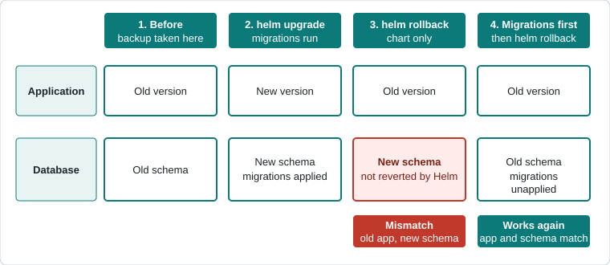

# Rolling Back to a Previous Version of Flagsmith

:::warning

These steps may result in data loss in the scenario where new models or fields have been added to the database. We
recommend taking a full backup of the database before completing the rollback.

:::

This page covers the process of rolling back to a previous version of Flagsmith. If you need to roll back to a previous
version, you will need to ensure that the database is also rolled back to the correct state. In order to do this, you
will need to unapply all the migrations that happened between the version that you want to roll back to and the one that
you are rolling back from. The following steps explain how to do that.

## Steps for v2.151.0 and Later

1. Identify the date and time that you deployed the version that you want to roll back to.

:::tip

If you are unsure about when you completed the previous deployment, you can use the `django_migrations` table as a
guide. If you query the table using the following query, you should see the migrations that have been applied (in
descending order), grouped in batches corresponding to each deployment.

```sql
SELECT *
FROM django_migrations
ORDER BY applied DESC
```

:::

2. Run the rollback command inside a Flagsmith API container running the _current_ version of Flagsmith:

```bash
python manage.py rollbackmigrationsappliedafter "<datetime from step 1>"
```

3. Roll back the Flagsmith API to the desired version.

## Steps for Versions Earlier Than v2.151.0

If you are rolling back from a version earlier than v2.151.0, you will need to replace step 2 above with the following
two steps.

### Step 1: Generate Rollback Commands

Replace the datetime in the query below with a datetime after the deployment of the version you want to roll back to,
and before any subsequent deployments. Execute the subsequent query against the Flagsmith database.

```sql {14} showLineNumbers
select
    concat('python manage.py migrate ',
    app,
    ' ',
    case
        when substring(name, 1, 4)::integer = 1 then 'zero'
        else lpad((substring(name, 1, 4)::integer - 1)::text, 4, '0')
        end
    ) as "python_commands"
from django_migrations
where id in (
    select min(id)
    from django_migrations
    where applied >= 'yyyy-MM-dd HH:mm:ss'
    group by app
);
```

Example output:

```
                python_commands
-----------------------------------------------
 python manage.py migrate multivariate 0007
 python manage.py migrate segment 0004
 python manage.py migrate environments 0034
 python manage.py migrate features 0064
 python manage.py migrate token_blacklist zero
```

### Step 2: Execute the Rollback Commands

Run the generated commands inside a Flagsmith API container running the _current_ version of Flagsmith.

## Upgrading and Rolling Back with Helm

This section covers a Flagsmith deployment that was installed with the Flagsmith Helm chart. An upgrade changes two
things: the application and the database schema. Helm manages the first, but not the second. That difference matters
most when you need to roll back.



### Before you upgrade

1. Read the release notes for every version between the one you run and the one you are moving to.
2. Note your current Helm revision, so you know what to roll back to:

   ```bash
   helm history -n flagsmith flagsmith
   ```

3. Back up the database and test that the backup restores. See the
   [PostgreSQL documentation](https://www.postgresql.org/docs/current/backup.html).

### Upgrade with Helm

```bash
helm upgrade -n flagsmith flagsmith flagsmith/flagsmith --version <chart-version> --reset-then-reuse-values \
  --wait --timeout 20m
```

`--reset-then-reuse-values` needs Helm 3.14 or later. It keeps the values you set when you installed and applies the new
chart's defaults for everything else. Avoid plain `--reuse-values`, which ignores defaults introduced by the new chart
version and can make an upgrade across versions fail. Values you pass with `-f` or `--set` are applied on top of the
values from your install, so only pass the ones you want to change.

`--wait` prints nothing until the rollout is ready. Helm treats a Deployment as ready when the minimum number of
replicas is available (the desired count minus `maxUnavailable`), so check `kubectl -n flagsmith get pods` to confirm
that every replica is ready. Downloading images can take several minutes on a slow connection, so allow a generous
`--timeout`.

:::warning

During a rolling upgrade, old API pods keep serving requests while the new pod runs its migrations. If a migration
removes something the old version needs, requests handled by an old pod can fail until it is replaced. If you cannot
accept errors during this window, schedule the upgrade for a quiet period.

:::

### How migrations run

With the chart's default values, database migrations run in an init container named `migrate-db` in the API pod, and the
API starts only after it finishes. To read its output, find the new API pod and request the init container's logs:

```bash
kubectl -n flagsmith get pods
kubectl -n flagsmith logs <api-pod> -c migrate-db
```

A successful run lists each migration it applied. If the database is already up to date, the log says
`No migrations to apply.`

The chart also has a `jobs.migrateDb` option that runs migrations as a Job. Check the chart values for your version.

:::warning

Init container logs exist only as long as the pod does. Once the API pod is replaced, the migration logs are gone. Read
them straight after the upgrade, or send pod logs to a log system.

:::

### Verify the upgrade

- `helm history -n flagsmith flagsmith` shows the new revision with the status `deployed`.
- `kubectl -n flagsmith get pods` shows the API pod as `Running` and ready.
- The dashboard shows the new version at the bottom of the left sidebar, and your projects and flags are still there.

### Rolling back with Helm

:::warning

`helm rollback` restores the previous chart revision, so the older application runs again. It does **not** undo database
migrations. If the upgrade changed the schema, the older application runs against a newer database and can fail.

:::

If you run only `helm rollback`, the API log can show an error like this:

```text
django.db.utils.ProgrammingError: relation "code_references_featureflagcodereferencesscan" does not exist
```

To roll back safely, unapply the database migrations first, then roll back the chart. You do not need to stop the API.

1. Pick a time after the previous deployment finished and before you ran `helm upgrade`, as described in
   [Steps for v2.151.0 and Later](#steps-for-v21510-and-later). Flagsmith records migration times in UTC, but
   `helm history` shows your local time, so convert it to UTC.
2. Run the rollback command in an API pod that runs the version you are rolling back from. It unapplies every migration
   applied on or after the time you give, which must be in ISO format:

   ```bash
   kubectl -n flagsmith exec deploy/flagsmith-api -- python manage.py rollbackmigrationsappliedafter "2026-11-19T10:12:03+00:00"
   ```

3. Roll back the chart:

   ```bash
   helm rollback flagsmith <revision> -n flagsmith --wait --timeout 20m
   ```

:::warning

Before Flagsmith 2.287.0, the migration `experimentation.0014_drop_ingestion_infrastructure_and_delivery_log` could not
be reversed. If the upgrade applied that migration and you run the rollback command in an earlier version, the command
stops partway with this error:

```text
django.core.exceptions.FieldDoesNotExist: WarehouseDeliveryLog has no field named 'connection'
```

Migrations that were already unapplied stay unapplied, and the rest stay applied. If this happens, restore the backup
you took before the upgrade. See the [PostgreSQL documentation](https://www.postgresql.org/docs/current/backup.html).
The migration was made reversible in [2.287.0](https://github.com/Flagsmith/flagsmith/releases/tag/v2.287.0).

:::

If you are rolling back from a version earlier than v2.151.0, replace step 2 with the steps in
[Steps for Versions Earlier Than v2.151.0](#steps-for-versions-earlier-than-v21510).

### Troubleshooting

| Symptom                                                    | Likely cause                                                  | What to do                                                                                                                  |
| ---------------------------------------------------------- | ------------------------------------------------------------- | --------------------------------------------------------------------------------------------------------------------------- |
| Dashboard says you do not have permission after a rollback | The older application cannot read the newer schema            | Check the API log for `ProgrammingError`. Upgrade to the newer chart version again, then follow **Rolling back with Helm**. |
| `helm install` or `helm upgrade` times out                 | Images are still downloading, or migrations are still running | Check `kubectl get pods` and `kubectl get events`. Retry with a longer `--timeout`.                                         |
| No migration Job exists to read logs from                  | Migrations run in the `migrate-db` init container by default  | Run `kubectl logs <api-pod> -c migrate-db` straight after the upgrade.                                                      |
| `kubectl logs <api-pod> -c migrate-db` returns `NotFound`  | The API pod was replaced and its logs were removed            | Upgrade again on a test copy and capture the logs immediately, or use a log system.                                         |

The permissions message in the first row is misleading. The dashboard shows it whenever a request fails.
