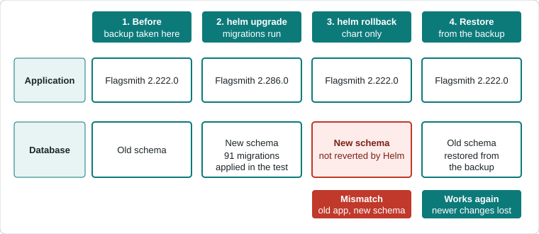

This page explains how to upgrade a self-hosted Flagsmith deployment that was installed with the Flagsmith Helm chart,
and what to do if you need to go back. It is based on a test upgrade from chart 0.80.0 (Flagsmith 2.222.0) to chart
0.85.0 (Flagsmith 2.286.0) on a local [kind](https://kind.sigs.k8s.io/) cluster with default values.

An upgrade changes two things: the application and the database schema. Helm manages the first, but not the second. That
difference matters most when you need to roll back.



## Before you upgrade

1. Read the release notes for every version between the one you run and the one you are moving to.
2. Note your current Helm revision, so you know what to roll back to:

   ```bash
   helm history -n flagsmith flagsmith
   ```

3. Back up the database, check the backup can be read, and store a copy outside the cluster. The commands below show how
   to do this for the PostgreSQL instance deployed by the chart.

### Back up the PostgreSQL instance deployed by the chart

:::info

These commands use the pod name `flagsmith-dev-postgresql-0`, the `postgres` user and the `POSTGRES_PASSWORD` and
`POSTGRES_DB` variables that were set in that pod during testing. Check them with
`kubectl -n flagsmith exec flagsmith-dev-postgresql-0 -- env`. If you use an external or managed database, use your
provider's snapshot or dump tools instead.

:::

```bash
kubectl -n flagsmith exec flagsmith-dev-postgresql-0 -- sh -c \
  'PGPASSWORD=$POSTGRES_PASSWORD pg_dump -U postgres -Fc -f /tmp/backup.dump $POSTGRES_DB'
```

Check the backup can be read. A number greater than zero means the file contains your tables:

```bash
kubectl -n flagsmith exec flagsmith-dev-postgresql-0 -- sh -c 'pg_restore -l /tmp/backup.dump | grep -c TABLE'
```

Copy the backup out of the cluster:

```bash
kubectl cp flagsmith/flagsmith-dev-postgresql-0:/tmp/backup.dump ./backup.dump
```

## Upgrade with Helm

```bash
helm upgrade -n flagsmith flagsmith flagsmith/flagsmith --version <chart-version> -f values.yaml --wait --timeout 20m
```

Pass the same values file you installed with. Without `-f` or `--reuse-values`, Helm applies the chart defaults and
discards values you set earlier. The test used default values only, so this behaviour was not tested here.

`--wait` prints nothing until every pod is ready. Downloading images can take several minutes on a slow connection. In
the test, a first install with a 10 minute timeout failed because the PostgreSQL image took more than five minutes to
download, even though the pods were healthy shortly afterwards.

## How migrations run

With the chart's default values, there is no migration Job. Database migrations run in an init container named
`migrate-db` in the API pod, and the API starts only after it finishes. To read its output, find the new API pod and
request the init container's logs:

```bash
kubectl -n flagsmith get pods
kubectl -n flagsmith logs <api-pod> -c migrate-db
```

A successful run lists each migration it applied. For example:

```text
Running migrations:
  Applying code_references.0003_introduce_per_feature_scanned_references... OK
```

If the database is already up to date, the log says `No migrations to apply.`

The chart also has a `jobs.migrateDb` option that runs migrations as a Job. This page did not test it, so check the
chart values for your version.

:::warning

Init container logs exist only as long as the pod does. Once the API pod is replaced, the migration logs are gone. Read
them straight after the upgrade, or send pod logs to a log system.

:::

## Verify the upgrade

- `helm history -n flagsmith flagsmith` shows the new revision with the status `deployed`.
- `kubectl -n flagsmith get pods` shows the API pod as `Running` and ready.
- The dashboard shows the new version at the bottom of the left sidebar, and your projects and flags are still there.

## Rolling back

:::warning

`helm rollback` restores the previous chart revision, so the older application runs again. It does **not** undo database
migrations. If the upgrade changed the schema, the older application runs against a newer database and can fail.

:::

In the test, migration `code_references.0003` dropped the table `code_references_featureflagcodereferencesscan`. After
`helm rollback`, Flagsmith 2.222.0 failed on the features list with this error in the API log:

```text
django.db.utils.ProgrammingError: relation "code_references_featureflagcodereferencesscan" does not exist
```

Treat a rollback as a restore. These steps worked in the test:

1. Roll back the chart:

   ```bash
   helm rollback flagsmith <revision> -n flagsmith --wait --timeout 20m
   ```

2. Stop the API, so nothing is connected to the database, and wait until no `flagsmith-api` pod is listed:

   ```bash
   kubectl -n flagsmith scale deployment flagsmith-api --replicas=0
   kubectl -n flagsmith get pods
   ```

3. Delete the database and create an empty one. This destroys the current data, so only do it once you have a backup you
   have checked:

   ```bash
   kubectl -n flagsmith exec flagsmith-dev-postgresql-0 -- sh -c 'PGPASSWORD=$POSTGRES_PASSWORD dropdb -U postgres $POSTGRES_DB'
   kubectl -n flagsmith exec flagsmith-dev-postgresql-0 -- sh -c 'PGPASSWORD=$POSTGRES_PASSWORD createdb -U postgres $POSTGRES_DB'
   ```

4. Restore the backup:

   ```bash
   kubectl -n flagsmith exec flagsmith-dev-postgresql-0 -- sh -c \
     'PGPASSWORD=$POSTGRES_PASSWORD pg_restore -U postgres -d $POSTGRES_DB --no-owner /tmp/backup.dump'
   ```

5. Start the API and wait for it to become ready:

   ```bash
   kubectl -n flagsmith scale deployment flagsmith-api --replicas=1
   kubectl -n flagsmith rollout status deployment flagsmith-api
   ```

Recreate the database rather than restoring over the existing one. Tables created by the newer version would otherwise
be left behind, and a later upgrade could fail when it tries to create them again.

:::warning

A restore returns the database to the moment of the backup. Anything saved since then is lost. In the test, a flag
created after the backup was gone after the restore.

:::

## Troubleshooting

| Symptom                                                    | Likely cause                                                  | What to do                                                                                     |
| ---------------------------------------------------------- | ------------------------------------------------------------- | ---------------------------------------------------------------------------------------------- |
| Dashboard says you do not have permission after a rollback | The older application cannot read the newer schema            | Check the API log for `ProgrammingError`. Restore the backup as described in **Rolling back**. |
| `helm install` or `helm upgrade` times out                 | Images are still downloading, or migrations are still running | Check `kubectl get pods` and `kubectl get events`. Retry with a longer `--timeout`.            |
| No migration Job exists to read logs from                  | Migrations run in the `migrate-db` init container by default  | Run `kubectl logs <api-pod> -c migrate-db` straight after the upgrade.                         |
| `kubectl logs <api-pod> -c migrate-db` returns `NotFound`  | The API pod was replaced and its logs were removed            | Upgrade again on a test copy and capture the logs immediately, or use a log system.            |

The permissions message in the first row is misleading. The dashboard shows it whenever a request fails, and in the test
the real cause was the missing table above.

## Changes in chart 0.85.0

Chart 0.85.0 no longer deploys the bundled InfluxDB. The notes printed by `helm upgrade` list the alternatives:
configure an external InfluxDB with `influxdbExternal`, or store analytics in PostgreSQL with `UsePostgresForAnalytics`
(which requires `taskProcessor.enabled`). To move existing analytics data to PostgreSQL, enable
`jobs.migrateAnalyticsData`.

These notes appear only in the terminal output, so check them if you upgrade through CI or a GitOps tool. This page did
not test what happens to existing analytics data.

## What was tested

- Upgrade, rollback and restore between chart 0.80.0 (Flagsmith 2.222.0) and chart 0.85.0 (Flagsmith 2.286.0).
- A local kind cluster, default values and the PostgreSQL instance deployed by the chart.
- A database containing one organisation, one project and a few flags.

Not tested: custom values, an external or managed database, the `jobs.migrateDb` Job, the analytics migration, other
version pairs, and downtime during the upgrade.
