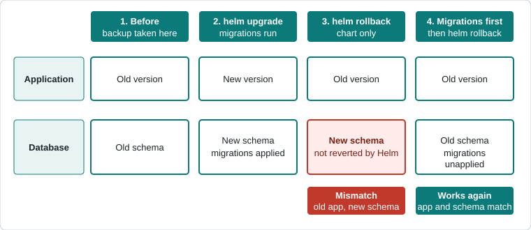

This page explains how to upgrade a self-hosted Flagsmith deployment that was installed with the Flagsmith Helm chart,
and what to do if you need to go back. It is based on a test upgrade from chart 0.80.0 (Flagsmith 2.222.0) to chart
0.85.0 (Flagsmith 2.286.0) on a local [kind](https://kind.sigs.k8s.io/) cluster with default values.

An upgrade changes two things: the application and the database schema. Helm manages the first, but not the second. That
difference matters most when you need to roll back.



## Before you upgrade

1. Read the release notes for every version between the one you run and the one you are moving to.
2. Note your current Helm revision, so you know what to roll back to:

   ```bash
   helm history -n flagsmith flagsmith
   ```

3. Note how many replicas the API runs. Look at the `READY` column, for example `2/2`, and write the number down: If
   your API uses autoscaling, the autoscaler can change the replica count on its own. This page did not test
   autoscaling.

   ```bash
   kubectl -n flagsmith get deployment flagsmith-api
   ```

4. Back up the database, verify the backup, and store a copy outside the cluster. The commands below show how to do this
   for the PostgreSQL instance deployed by the chart.

### Back up the PostgreSQL instance deployed by the chart

:::info

These commands use the pod name `flagsmith-dev-postgresql-0`, the `postgres` user and the `POSTGRES_PASSWORD` and
`POSTGRES_DB` variables that were set in that pod during testing. Find your PostgreSQL pod name with
`kubectl -n flagsmith get pods` , then check the variables with `kubectl -n flagsmith exec <postgres-pod> -- env`. If
you use an external or managed database, use your provider's snapshot or dump tools instead.

:::

The dump is written inside the PostgreSQL pod first, so check there is enough free space:

```bash
kubectl -n flagsmith exec flagsmith-dev-postgresql-0 -- df -h /tmp
```
This checks the space for the dump file. The scratch restore below also creates a full second copy of the database on the volume where PostgreSQL stores its data, so check that volume has more free space than the database uses. If it does not, skip the scratch restore or run it on a separate PostgreSQL server. This was not tested.

Create the backup:

```bash
kubectl -n flagsmith exec flagsmith-dev-postgresql-0 -- sh -c \
  'PGPASSWORD=$POSTGRES_PASSWORD pg_dump -U postgres -Fc -f /tmp/backup.dump $POSTGRES_DB'
```

Copy it out of the cluster, so it survives if the pod is replaced:

```bash
kubectl cp flagsmith/flagsmith-dev-postgresql-0:/tmp/backup.dump ./backup.dump
```

Verify the backup by restoring it into a scratch database. If this prints no errors, the backup can be restored:

```bash
kubectl -n flagsmith exec flagsmith-dev-postgresql-0 -- sh -c \
  'PGPASSWORD=$POSTGRES_PASSWORD createdb -U postgres flagsmith_verify'
kubectl -n flagsmith exec flagsmith-dev-postgresql-0 -- sh -c \
  'PGPASSWORD=$POSTGRES_PASSWORD pg_restore -U postgres -d flagsmith_verify --single-transaction /tmp/backup.dump'
```

Compare the number of tables in the scratch database with the live one. The two numbers should match:

```bash
kubectl -n flagsmith exec flagsmith-dev-postgresql-0 -- sh -c \
  'PGPASSWORD=$POSTGRES_PASSWORD psql -U postgres -d flagsmith_verify -c \\dt | grep -c table'
kubectl -n flagsmith exec flagsmith-dev-postgresql-0 -- sh -c \
  'PGPASSWORD=$POSTGRES_PASSWORD psql -U postgres -d $POSTGRES_DB -c \\dt | grep -c table'
```

Then remove the scratch database. Run this command only if `createdb` succeeded. If `createdb` failed, the database already existed, so do not drop it.

```bash
kubectl -n flagsmith exec flagsmith-dev-postgresql-0 -- sh -c \
  'PGPASSWORD=$POSTGRES_PASSWORD dropdb -U postgres flagsmith_verify'
```

## Upgrade with Helm

```bash
helm upgrade -n flagsmith flagsmith flagsmith/flagsmith --version <chart-version> --reset-then-reuse-values \
  --wait --timeout 20m
```

`--reset-then-reuse-values` needs Helm 3.14 or later. It keeps the values you set when you installed and applies the new
chart's defaults for everything else. Avoid plain `--reuse-values`, which ignores defaults introduced by the new chart
version and can make an upgrade across versions fail. Values you pass with -f or --set are applied on top of the values
from your install, so only pass the ones you want to change. The test used default values only, so this behaviour was
not tested with custom values.

`--wait` prints nothing until the rollout is ready. Helm treats a Deployment as ready when the minimum number of
replicas is available (the desired count minus `maxUnavailable`), so check `kubectl -n flagsmith get pods` to confirm
that every replica is ready. Downloading images can take several minutes on a slow connection. In the test, a first
install with a 10 minute timeout failed because the PostgreSQL image took more than five minutes to download, even
though the pods were healthy shortly afterwards.

:::warning

During a rolling upgrade, old API pods keep serving requests while the new pod runs its migrations. If a migration
removes something the old version needs, requests handled by an old pod can fail until it is replaced. In the test,
migration `code_references.0003` dropped a table that Flagsmith 2.222.0 reads. If you cannot accept errors during this
window, schedule the upgrade for a quiet period. This was not tested.

:::

## How migrations run

With the chart's default values, there is no migration Job. Database migrations run in an init container named
`migrate-db` in the API pod, and the API starts only after it finishes. To read its output, find the new API pod and
request the init container's logs:

```bash
kubectl -n flagsmith get pods
kubectl -n flagsmith logs <api-pod> -c migrate-db
```

A successful run lists each migration it applied. For example:

```text
Running migrations:
  Applying code_references.0003_introduce_per_feature_scanned_references... OK
```

If the database is already up to date, the log says `No migrations to apply.`

The chart also has a `jobs.migrateDb` option that runs migrations as a Job. This page did not test it, so check the
chart values for your version.

:::warning

Init container logs exist only as long as the pod does. Once the API pod is replaced, the migration logs are gone. Read
them straight after the upgrade, or send pod logs to a log system.

:::

## Verify the upgrade

- `helm history -n flagsmith flagsmith` shows the new revision with the status `deployed`.
- `kubectl -n flagsmith get pods` shows the API pod as `Running` and ready.
- The dashboard shows the new version at the bottom of the left sidebar, and your projects and flags are still there.

## Rolling back

:::warning

`helm rollback` restores the previous chart revision, so the older application runs again. It does **not** undo database
migrations. If the upgrade changed the schema, the older application runs against a newer database and can fail.

:::

In the test, migration `code_references.0003` dropped the table `code_references_featureflagcodereferencesscan`. After
`helm rollback`, Flagsmith 2.222.0 failed on the features list with this error in the API log:

```text
django.db.utils.ProgrammingError: relation "code_references_featureflagcodereferencesscan" does not exist
```

Treat a rollback as a restore. These steps worked in the test:

1. Roll back the chart:

   ```bash
   helm rollback flagsmith <revision> -n flagsmith --wait --timeout 20m
   ```

2. Stop the API, so nothing is connected to the database, and wait until no `flagsmith-api` pod is listed: 
   Stop everything that connects to the database, and wait until none of those pods is listed. In the default install only the API connects. If you enabled the task processor, note its replica count, then scale it to 0 as well, and wait for any migration Job to finish. These setups were not tested.

   ```bash
   kubectl -n flagsmith scale deployment flagsmith-api --replicas=0
   kubectl -n flagsmith get pods
   ```

3. Copy the backup into the PostgreSQL pod and check it is there. The pod may have been replaced since you took the
   backup, so do this even if you think the file is still in `/tmp`:

   ```bash
   kubectl cp ./backup.dump flagsmith/flagsmith-dev-postgresql-0:/tmp/backup.dump
   kubectl -n flagsmith exec flagsmith-dev-postgresql-0 -- ls -l /tmp/backup.dump
   ```

4. Delete the database and create an empty one. This destroys the current data, so only do it once you have a backup you
   have verified: Run these commands one at a time, and check each one finishes without an error before you run the
   next. If dropdb fails because the database is in use, stop. Do not run createdb or pg_restore until you have found
   what is still connected.

   ```bash
   kubectl -n flagsmith exec flagsmith-dev-postgresql-0 -- sh -c \
     'PGPASSWORD=$POSTGRES_PASSWORD dropdb -U postgres $POSTGRES_DB'
   kubectl -n flagsmith exec flagsmith-dev-postgresql-0 -- sh -c \
     'PGPASSWORD=$POSTGRES_PASSWORD createdb -U postgres $POSTGRES_DB'
   ```

5. Restore the backup. `--single-transaction` makes the restore all or nothing, so a failure cannot leave a half
   restored database. If the command reports any error, do not start the API. Fix the cause and run it again:

   ```bash
   kubectl -n flagsmith exec flagsmith-dev-postgresql-0 -- sh -c \
     'PGPASSWORD=$POSTGRES_PASSWORD pg_restore -U postgres -d $POSTGRES_DB --single-transaction /tmp/backup.dump'
   ```

   `pg_restore` recreates the original table owners, so the database roles must already exist. They do when you restore
   into the same database server.

6. Start the API with the replica count you noted before the upgrade, and wait for it to become ready:

   ```bash
   kubectl -n flagsmith scale deployment flagsmith-api --replicas=<replica-count>
   kubectl -n flagsmith rollout status deployment flagsmith-api
   ```
If you stopped the task processor, scale it back to the replica count you noted, so background tasks run again. This was not tested.
Recreate the database rather than restoring over the existing one. Tables created by the newer version would otherwise
be left behind, and a later upgrade could fail when it tries to create them again.

:::warning

A restore returns the database to the moment of the backup. Anything saved since then is lost. In the test, a flag
created after the backup was gone after the restore.

:::

## Troubleshooting

| Symptom                                                    | Likely cause                                                  | What to do                                                                                     |
| ---------------------------------------------------------- | ------------------------------------------------------------- | ---------------------------------------------------------------------------------------------- |
| Dashboard says you do not have permission after a rollback | The older application cannot read the newer schema            | Check the API log for `ProgrammingError`. Restore the backup as described in **Rolling back**. |
| `helm install` or `helm upgrade` times out                 | Images are still downloading, or migrations are still running | Check `kubectl get pods` and `kubectl get events`. Retry with a longer `--timeout`.            |
| No migration Job exists to read logs from                  | Migrations run in the `migrate-db` init container by default  | Run `kubectl logs <api-pod> -c migrate-db` straight after the upgrade.                         |
| `kubectl logs <api-pod> -c migrate-db` returns `NotFound`  | The API pod was replaced and its logs were removed            | Upgrade again on a test copy and capture the logs immediately, or use a log system.            |

The permissions message in the first row is misleading. The dashboard shows it whenever a request fails, and in the test
the real cause was the missing table above.

## Changes in chart 0.85.0

Chart 0.85.0 no longer deploys the bundled InfluxDB. The notes printed by `helm upgrade` list the alternatives:
configure an external InfluxDB with `influxdbExternal`, or store analytics in PostgreSQL with `UsePostgresForAnalytics`
(which requires `taskProcessor.enabled`). The notes also mention `jobs.migrateAnalyticsData` for moving existing
analytics data.

These notes appear only in the terminal output, so check them if you upgrade through CI or a GitOps tool. This page did
not test the analytics migration or what happens to existing analytics data, so check the chart values for the settings
that job needs, including the connection to the source InfluxDB.

## What was tested

- Upgrade, rollback and restore between chart 0.80.0 (Flagsmith 2.222.0) and chart 0.85.0 (Flagsmith 2.286.0).
- A local kind cluster, default values and the PostgreSQL instance deployed by the chart.
- A database containing one organisation, one project and a few flags.

Not tested: custom values, an external or managed database, the `jobs.migrateDb` Job, the analytics migration, other
version pairs, and the behaviour of the API and downtime during a rolling upgrade.
