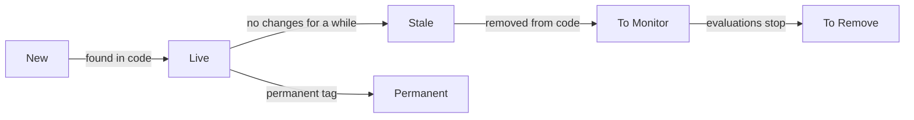

The busy age of today makes it easy to forget feature flags in the code, and keep them either enabled — or disabled —
forever. They even overlap and nest sometimes, and create a grey area in feature flag management in which _nobody will
ever touch those features because things just work as they are_. For most of us, software management is already too busy
to fit in feature flag hygiene.

:::tip

As a good practice, feature flags should not live forever.

Most of the time, the ultimate goal of a feature flag is to help serve new software to audiences in a controlled way,
for example with [percentage rollouts](/managing-flags/rollout/rollout-by-percentage). Once the feature is fully rolled
out, the feature flag can be safely removed.

:::

Feature Lifecycle highlights features at each stage of the development and release process, making it easier to spot
feature flags that should be removed: first from the code, then from Flagsmith. Find it under **Lifecycle** in your
project's navigation.

## The stages of a feature flag

Within its life, and in the Lifecycle tab, a feature flag goes through these stages:

- `New`: Created in Flagsmith, but not in the code yet. Becomes `Live` once a code scan finds it.
- `Live`: In the code and still being rolled out. Nothing to do.
- `Permanent`: Meant to stay, e.g. a kill switch. Never flagged for clean-up.
- `Stale`: Still in the code, but [untouched for a while](/managing-flags/stale-flags). Time to remove it from the code.
- `To Monitor`: Gone from the code, but still being evaluated, e.g. by an older release of the application. Wait before
  deleting.
- `To Remove`: Gone from the code and no longer evaluated. Safe to delete from Flagsmith.

## How to set up

Make sure you set up [Code References](/managing-flags/code-references). Flagsmith does not have access to your
codebase, and only keeps track of where feature flags are referenced (file names and line numbers).

SDKs evaluating feature flags must also enable [Flag Analytics](/managing-flags/flag-analytics), so that Flagsmith knows
about per-feature usage.

The `Stale`, `To Monitor` and `To Remove` stages rely on
[Stale Flag Detection](/managing-flags/stale-flags#requirements), available on the **Scale-up** and **Enterprise**
plans.

:::note Self-hosted

Self-hosted installations of Flagsmith also need to ensure Flag Analytics is available on the API side. See
[Environment Variables](/deployment-self-hosting/core-configuration/environment-variables).

:::
