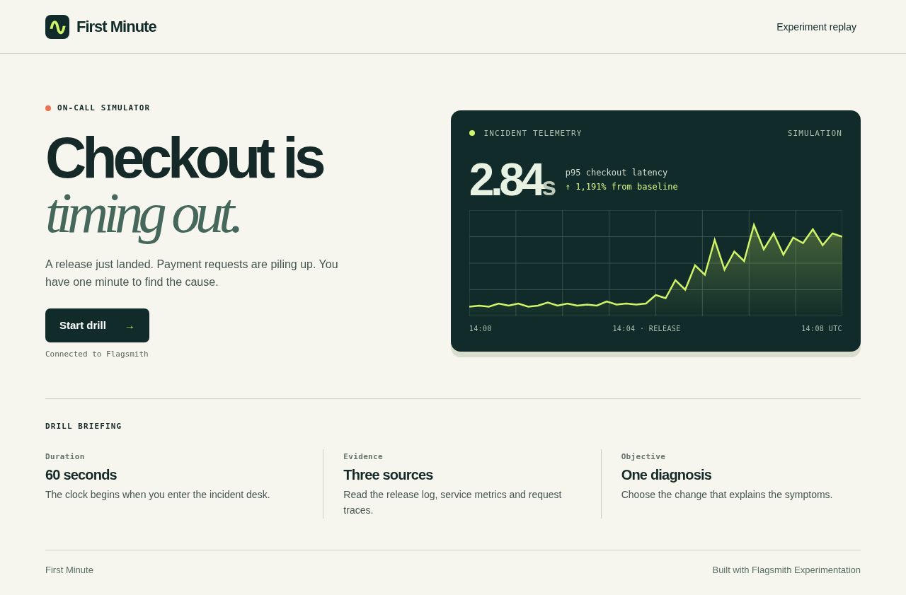
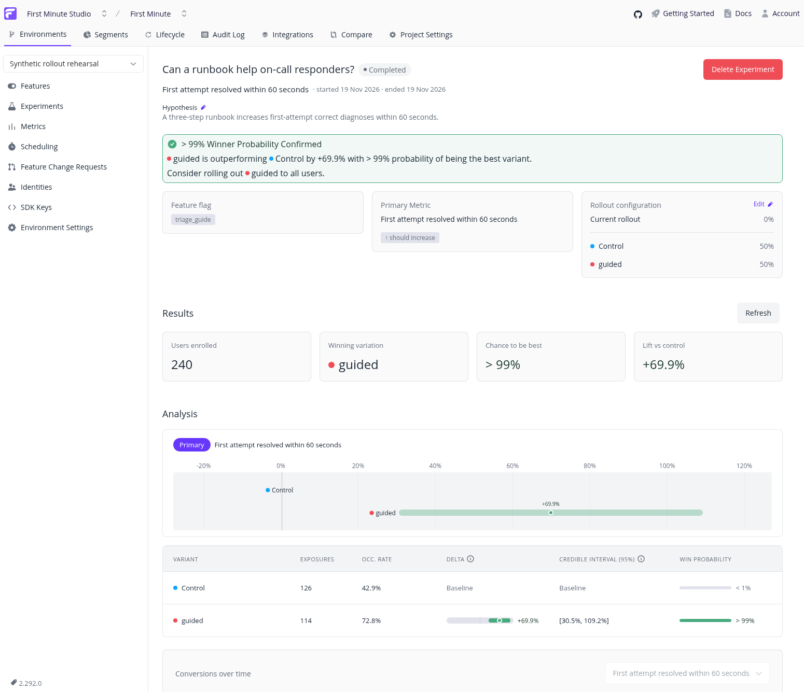

# First Minute

A 60-second incident drill that tests whether a short runbook helps people diagnose a checkout outage. Participants inspect a release log, service metrics and request traces, choose one diagnosis, and see where the slow request spent its time.



[Watch the 38-second captioned walkthrough](media/walkthrough.mp4)

## Play

For a no-install practice round, [download the drill](https://raw.githubusercontent.com/arpitkjaiswal/flagsmith1/main/examples/first-minute/media/first-minute.zip), unzip it and open `first-minute.html`. The debrief includes a capacity model where you can adjust the pool size and see the resulting queue growth.

To run from source, run `npm ci` and `npm run dev` with Node 24. Open the address Vite prints. Without a client-side environment key, the drill runs in practice mode. To make a portable, offline copy, run `npm run build:practice` and open `dist/first-minute.html`. Finish a round and choose **Try the other desk** to compare the layouts.

## Run the experiment locally

1. Start Flagsmith with Experimentation enabled, create an organisation, and sign in. The provided Compose setup uses PostgreSQL as the event warehouse.
2. Supply a **local Flagsmith user authentication token** with project and environment management rights in `FLAGSMITH_MANAGEMENT_TOKEN`. Use Python 3 to run `python setup_experiment.py ORGANISATION_ID` from this directory. The script creates or reuses the First Minute project, Participant drill environment, warehouse connection, feature, metric and experiment. It starts the experiment and prints the client environment key and dashboard URL as browser configuration lines. Copy both into `.env.local`. Keep management credentials outside the checkout.
3. Start or restart Vite. Its local SDK proxy forwards flags, identities and events to Flagsmith on port 8000. The briefing should say **Connected to Flagsmith**. Start the drill to enrol. For self-hosted deployments on another origin, set `VITE_FLAGSMITH_ORIGIN` to the HTTPS origin serving both the Flagsmith API and SDK events before running `npm run build`. Serve the generated `dist` directory over HTTPS.
4. Open **Experiments** in the Participant drill environment and refresh the results after events arrive. The guide is a keyed variation of the `triage_guide` multivariate flag. All eligible identities enter the experiment, with equal allocation between control and guided.

If the self-hosted dashboard shows **Maintenance** because its bootstrap request is blocked, configure `FLAGSMITH_ON_FLAGSMITH_API_URL` and `FLAGSMITH_ON_FLAGSMITH_API_KEY` on the web service to read from a local dashboard configuration environment, then restart the service. [Self-hosting guide](../../docs/docs/deployment-self-hosting/core-configuration/running-flagsmith-on-flagsmith.md)

## What the experiment measures

**Hypothesis.** A three-step runbook increases the fraction of first-time participants who correctly diagnose connection-pool exhaustion within 60 seconds. Both variants use identical evidence, answer choices, time limit and feedback.

**Measurement.** The browser stores an anonymous identity and the first attempt's deadline. Opening the desk records an SDK exposure. Only a correct first answer before expiry records the `drill_resolved` occurrence event. Reloading preserves the deadline and restores a finished debrief. Tabs sharing the same browser identity share one first answer. Replays are practice. A new browser profile is a new identity.

**Evidence.** The [browser smoke-test snapshot](verification.json) recorded three exposures and two conversions. The in-app **Experiment replay** follows a larger synthetic run through assignment, measurement and rollout. Both runs used the real Flagsmith SDK and a local Flagsmith instance.

**Rollout.** Collect independent participant attempts and inspect sample-ratio warnings. Flagsmith shows “Collecting data” below its inference thresholds. Once sufficient evidence supports a decision, end the participant experiment and use the same flag to roll out the selected desk. If the evidence stays inconclusive, continue collecting data.

## Replay the Flagsmith experiment

Open **Experiment replay** in the drill. Assignment shows how the multivariate flag split 240 simulated identities. Results compares 83 conversions from 114 guided attempts with 54 from 126 standard attempts. The script programmed a 72% success chance for guided and 45% for standard. Flagsmith calculated the conversion rates, relative lift and win probability for this synthetic sample. Human outcomes are measured in the **Participant drill** environment.

Rollout shows what happened after the synthetic experiment closed. The same `triage_guide` flag was set to 100% guided in **Synthetic rollout rehearsal**. All 16 post-rollout SDK checks received the guided desk outside the experiment. The replay and its downloadable data work offline.



To reproduce the capture, use the local Flagsmith instance and token from the setup above. From this directory, run the following with your numeric organisation ID.

```sh
python rehearse.py ORGANISATION_ID
```

This command provisions the dedicated rehearsal environment. It sends seeded traffic through the JavaScript SDK, checks the warehouse counts against the events it sent, and uses the Flagsmith results to select a desk. It pauses enrolment before closing the rehearsal and updating the environment default. A repeated run against a completed rehearsal verifies the rollout again. The JSON contains aggregate evidence only. The allocation check uses an exact two-sided binomial test against 50/50 when Flagsmith leaves its sample-ratio statistic empty.

The [captured JSON](rehearsal.json) drives the replay. To replace it after your own successful run, save the command output to a temporary file, then move it to `rehearsal.json`. The dashboard capture is a separate image taken from the original run shown here.

## Browser checks

Run `npx playwright install chromium` once, then `npm test`. To use an existing Chromium installation, set `CHROMIUM_EXECUTABLE` to its path. These tests intercept SDK traffic locally and check simultaneous submissions, restored first attempts and practice exclusions. The rehearsal command above exercises the real API and warehouse.

## Submission copy

When checkout slows down, a responder often has a dashboard full of signals and has to work out what changed. First Minute lets anyone take the on-call seat. Players have 60 seconds to trace a slowdown through a release, service metrics and a slow request. Flagsmith assigns a plain desk or a three-step runbook and measures whether the player finds the root cause on their first attempt. The result helps the team decide whether every new responder should get the guide.
